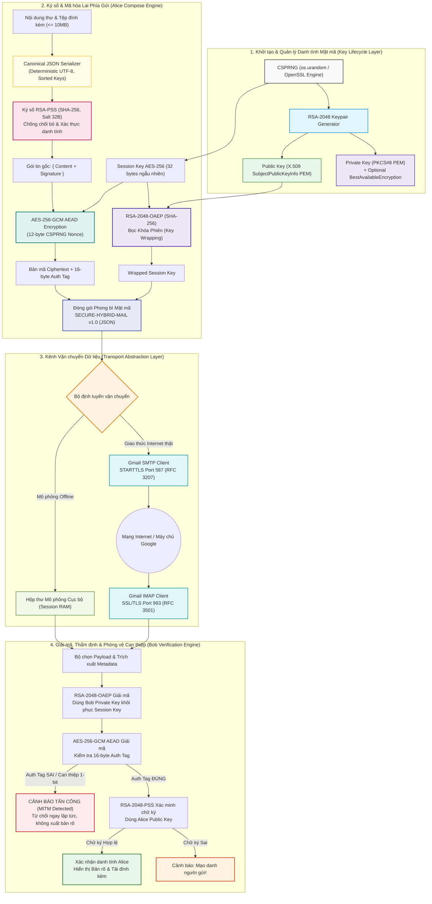

# Secure Hybrid Email Laboratory (CipherMail)

[](https://www.python.org/)
[](https://streamlit.io/)
[](https://cryptography.io/)
[](https://csrc.nist.gov/publications/detail/sp/800-38d/final)
[](https://datatracker.ietf.org/doc/html/rfc8017)
[](https://pytest.org/)
[](LICENSE)

Nền tảng phòng lab tương tác chuyên sâu mô phỏng toàn diện quy trình bảo vệ thư điện tử bằng kỹ thuật **Mã hóa lai (Hybrid Encryption)** và **Chữ ký số (Digital Signature)** chuẩn mật mã học hiện đại. Ứng dụng hỗ trợ mô hình truyền tin an toàn đầu-cuối giữa hai thực thể (Alice & Bob), tích hợp cơ chế phát hiện tấn công can thiệp dữ liệu (**MITM Bit-Flipping Detection**) và vận chuyển linh hoạt qua hộp thư giả lập hoặc tài khoản Gmail thực tế (**SMTP STARTTLS / IMAP SSL**).

Được thiết kế phục vụ báo cáo, đánh giá học thuật và thực hành chuyên sâu môn **An toàn Thông tin**, hệ thống hiện thực hóa trọn vẹn bộ mật mã: **AES-256-GCM (AEAD)**, **RSA-2048-OAEP-SHA256 (Key Encapsulation)**, **RSA-2048-PSS-SHA256 (Chống chối bỏ)** và **Canonical JSON Serialization**.

---

## 1. Kiến trúc Hệ thống (System Architecture)



---

## 2. Điểm Nhấn Kỹ thuật & Hiện thực Mật mã (Engineering Highlights)

### 🔹 Chuẩn Mã hóa Xác thực AEAD (`AES-256-GCM`)
Bảo vệ nội dung email và toàn bộ file đính kèm với thuật toán mã hóa đối xứng có xác thực:
- **Cấu trúc bảo vệ**: Mỗi thông điệp được mã hóa bằng khóa phiên 256-bit độc lập, Nonce ngẫu nhiên 12-byte (96-bit) sinh từ CSPRNG, và xuất ra Thẻ xác thực **Auth Tag 16-byte (128-bit)**.
- **Phát hiện can thiệp tức thì (Bit-Flipping Immunity)**: Nếu bản mã bị kẻ tấn công trên đường truyền đảo dù chỉ 1 bit, giải thuật GCM lập tức phát hiện sai lệch Auth Tag và ném ngoại lệ `InvalidTag`. Bản rõ tuyệt đối không được giải mã, ngăn chặn triệt để tấn công Chosen-Ciphertext Attacks (CCA).

### 🔹 Bọc Khóa Phiên Đệm Kháng Tấn công (`RSA-2048-OAEP`)
- Sử dụng hàm băm **SHA-256** và hàm sinh mặt nạ **MGF1** cho cơ chế đệm OAEP.
- Loại bỏ hoàn toàn lỗ hổng Bleichenbacher xuất hiện trên các hệ thống cũ dùng chuẩn đệm lỗi thời PKCS#1 v1.5. Khóa đối xứng AES chỉ có thể được mở bởi duy nhất khóa riêng của người nhận đích danh.

### 🔹 Chữ ký số Chống chối bỏ Tiên tiến (`RSA-2048-PSS`)
- Áp dụng sơ đồ ký số xác suất **PSS (Probabilistic Signature Scheme)** với độ dài Salt cố định 32-byte và băm SHA-256.
- Đảm bảo tính xác thực nguồn gốc (Authenticity) và tính chống chối bỏ (Non-repudiation). Người gửi không thể phủ nhận thông điệp đã phát hành, đồng thời chữ ký thay đổi ngẫu nhiên qua mỗi phiên ký dù nội dung giống nhau.

### 🔹 Tuần tự hóa Xác định (`Deterministic Canonical JSON`)
- Để chữ ký số không bị hỏng khi trao đổi giữa các môi trường khác nhau, dữ liệu ký được chuẩn hóa qua hàm `_canonical_json`: loại bỏ ký tự trắng dư thừa (`separators=(',', ':')`), ép buộc bảng mã UTF-8 và sắp xếp khóa theo thứ tự từ điển (`sort_keys=True`).

### 🔹 Cách ly Thông tin Nhạy cảm & An toàn Tuyệt đối (Zero-Leak Policy)
- Khóa riêng xuất ra file PEM được bảo vệ bằng chuẩn mã hóa **PKCS#8** kết hợp mật khẩu người dùng (`BestAvailableEncryption`).
- Cơ chế đọc `.env` cô lập an toàn; mã nguồn không ghi log mật khẩu ứng dụng Gmail (App Password), khóa bí mật hay bản rõ nội dung ra stdout/stderr.

---

## 3. Ngăn xếp Công nghệ (Technology Stack)

| Tầng kiến trúc | Thành phần | Công nghệ / Giao thức | Phiên bản | Mục đích sử dụng |
| :--- | :--- | :--- | :--- | :--- |
| **Giao diện Người dùng** | Web Presentation | **Streamlit** | $\ge 1.40.0$ | Giao diện tương tác 3 tab, biểu đồ tiến trình thời gian thực |
| **Môi trường Thực thi** | Runtime Core | **Python** | $3.11$ / $3.12$ | Nền tảng thực thi logic hệ thống |
| **Lõi Mật mã** | Cryptographic Engine | **cryptography** (PyCA) | $\ge 43.0.0$ | Cung cấp các primitives toán học chuẩn OpenSSL FIPS |
| **Mã hóa Đối xứng** | Symmetric Cipher | **AES-256-GCM** | FIPS 197 | Mã hóa bản rõ và tệp đính kèm kèm xác thực toàn vẹn (AEAD) |
| **Bọc Khóa Phiên** | Key Encapsulation | **RSA-2048-OAEP** | RFC 8017 | Bọc khóa AES-256 bằng khóa công khai người nhận |
| **Chữ ký số** | Digital Signature | **RSA-2048-PSS** | RFC 8017 | Ký số xác thực danh tính người gửi (SHA-256, Salt 32B) |
| **Định dạng Vận chuyển**| Payload Envelope | **JSON / Base64** | Schema v1.0 | Đóng gói phong bì `SECURE-HYBRID-MAIL` chuẩn hóa |
| **Giao thức Mạng (Gửi)**| Mail Transport (Out) | **SMTP + STARTTLS** | Port 587 | Kết nối mã hóa TLS gửi thư tới Google Gmail SMTP |
| **Giao thức Mạng (Nhận)**| Mail Transport (In) | **IMAP + SSL/TLS** | Port 993 | Kết nối mã hóa SSL tải thư bảo mật từ Google Gmail IMAP |
| **Quản lý Cấu hình** | Environment Loader | **python-dotenv** | $\ge 1.0.1$ | Nạp cấu hình bảo mật từ `.env` vào bộ nhớ |
| **Đảm bảo Chất lượng** | Automated Testing | **pytest + AppTest** | $\ge 8.3.0$ | Kiểm thử toàn vẹn mật mã, mock mạng và smoke test UI |

---

## 4. Cấu trúc Thư mục Dự án (Repository Structure)

```text
ANM/
├── app.py                      # Giao diện chính Streamlit & Quản lý luồng tương tác 3 Tabs
├── src/                        # Thư mục chứa mã nguồn nghiệp vụ cốt lõi
│   ├── __init__.py             # Khởi tạo gói module Python
│   ├── config.py               # Xử lý biến môi trường, MailConfig và hằng số giới hạn
│   ├── crypto_engine.py        # Động cơ mật mã: AES-GCM, RSA-OAEP, RSA-PSS, Envelope v1.0
│   ├── key_manager.py          # Quản lý vòng đời RSA: sinh khóa, xuất/nhập PKCS#8 PEM, Fingerprint
│   └── mail_service.py         # Module mạng: Gửi SMTP STARTTLS và nhận IMAP SSL Gmail
├── tests/                      # Bộ kiểm thử tự động toàn diện
│   ├── __init__.py
│   ├── test_flow.py            # Kiểm thử luồng mật mã, kiểm thử phát hiện lỗi đảo 1-bit MITM
│   ├── test_mail_service.py    # Kiểm thử logic phân tích cú pháp tiêu đề, payload email
│   └── test_app_smoke.py       # Kiểm thử giao diện Streamlit AppTest khởi động không lỗi
├── .streamlit/
│   └── config.toml             # Cấu hình giao diện tùy chỉnh (Forest/Mint Palette, Max Upload)
├── .codex/
│   └── hooks.json              # Cấu hình kiểm tra UI & tự động hóa Codex
├── .env.example                # Tệp cấu hình mẫu (Mẫu khai báo Gmail credentials)
├── .gitignore                  # Chặn rò rỉ khóa bí mật, file .env, cache và môi trường ảo
├── PRODUCT.md                  # Tài liệu đặc tả sản phẩm & kiến trúc hệ thống chi tiết
├── requirements.txt            # Danh sách thư viện phụ thuộc
└── README.md                   # Tài liệu hướng dẫn kỹ thuật chính (Tài liệu này)
```

---

## 5. Hướng dẫn Cài đặt & Chuẩn bị Môi trường

### Yêu cầu Tiên quyết
- **Hệ điều hành**: Windows 10/11, Ubuntu 20.04+, macOS (Đã kiểm thử tối ưu trên Windows PowerShell).
- **Python**: Phiên bản `3.10`, `3.11` hoặc `3.12` (Khuyên dùng: **Python 3.11.9**).
- **Bộ nhớ (RAM)**: Tối thiểu 2 GB RAM trống.
- **Mạng**: Cần kết nối Internet nếu sử dụng kênh vận chuyển Gmail thật.

---

### Bước 1: Khởi tạo Môi trường Ảo (Virtual Environment)

Mở **PowerShell** tại thư mục dự án `C:\Users\Admin\ANM`:

```powershell
# Tạo môi trường ảo .venv biệt lập
python -m venv .venv
```

> [!NOTE]
> **Xử lý chính sách bảo mật PowerShell trên Windows (`ExecutionPolicy Restricted`):**  
> Mặc định Windows chặn chạy các script `.ps1`. Để tránh hoàn toàn các lỗi xung đột quyền, bạn có thể **gọi trực tiếp trình thông dịch** `.\.venv\Scripts\python.exe` trong các bước tiếp theo, hoặc mở quyền tạm thời cho phiên làm việc hiện tại bằng lệnh:
> ```powershell
> Set-ExecutionPolicy -Scope Process -ExecutionPolicy Bypass
> .\.venv\Scripts\Activate.ps1
> ```

---

### Bước 2: Cài đặt Thư viện Phụ thuộc (`requirements.txt`)

Nâng cấp trình quản lý `pip` và cài đặt các thư viện mật mã:

```powershell
.\.venv\Scripts\python.exe -m pip install --upgrade pip
.\.venv\Scripts\python.exe -m pip install -r requirements.txt
```

---

### Bước 3: Chạy Bộ Kiểm thử Xác nhận Tự động (`pytest`)

Trước khi khởi động giao diện, chạy toàn bộ bộ kiểm thử để xác minh tính đúng đắn của các giải thuật toán học:

```powershell
.\.venv\Scripts\python.exe -m pytest -v
```

*Kết quả mong đợi:*
```text
tests/test_flow.py::test_aes_gcm_round_trip PASSED
tests/test_flow.py::test_aes_gcm_detects_one_bit_change PASSED
tests/test_flow.py::test_rsa_pss_signature_rejects_modified_message PASSED
tests/test_flow.py::test_rsa_oaep_only_unwraps_with_the_intended_recipient PASSED
tests/test_flow.py::test_complete_sign_encrypt_decrypt_verify_flow PASSED
tests/test_flow.py::test_complete_flow_rejects_tampered_ciphertext PASSED
tests/test_mail_service.py::test_mail_config_normalizes_app_password PASSED
tests/test_mail_service.py::test_blank_credentials_are_not_configured PASSED
tests/test_mail_service.py::test_subject_contains_secure_transport_marker PASSED
tests/test_mail_service.py::test_payload_parser_rejects_other_protocols PASSED
tests/test_app_smoke.py::test_streamlit_app_renders_without_exceptions PASSED

======================== 11 passed in 1.45s ========================
```

---

### Bước 4: Cấu hình Tài khoản Gmail (Tùy chọn)

- **Nếu chạy mô phỏng hoàn toàn trên máy**: Bỏ qua bước này, hệ thống tích hợp sẵn kênh *Hộp thư mô phỏng cục bộ* mà không cần tài khoản hay cấu hình.
- **Nếu chạy gửi nhận qua Gmail thật**:
  1. Tạo file `.env` tại thư mục gốc dự án:
     ```powershell
     Copy-Item .env.example .env
     ```
  2. Bật Xác minh 2 bước cho tài khoản Google $\rightarrow$ Truy cập [myaccount.google.com/apppasswords](https://myaccount.google.com/apppasswords).
  3. Tạo **Mật khẩu ứng dụng (App Password)** và điền thông tin vào file `.env`:
     ```dotenv
     GMAIL_USER=your_email@gmail.com
     GMAIL_APP_PASSWORD=xxxx xxxx xxxx xxxx
     SMTP_HOST=smtp.gmail.com
     SMTP_PORT=587
     IMAP_HOST=imap.gmail.com
     IMAP_PORT=993
     MAIL_MODE=gmail
     PORT=4173
     ```

---

### Bước 5: Khởi chạy Ứng dụng Web

Thực thi lệnh khởi chạy Streamlit:

```powershell
.\.venv\Scripts\python.exe -m streamlit run app.py
```

Truy cập giao diện phòng lab tại trình duyệt: **`http://localhost:8501`**

---

## 6. Kịch bản Thực hành & Báo cáo Demo (Execution Scenarios)

### 🚀 Kịch bản 1: Luồng Nghiệp vụ Chuẩn (Alice gửi thư bảo mật cho Bob)
> **Mục tiêu**: Chứng minh quy trình bảo vệ toàn diện qua 3 giai đoạn: Tạo danh tính $\rightarrow$ Mã hóa & Ký $\rightarrow$ Giải mã & Xác minh.

1. **Tab `01 · Khóa`**:
   - Nhập mật khẩu bảo vệ khóa nếu cần.
   - Nhấn **Tạo cặp khóa Alice & Bob**.
   - Hệ thống sinh ngẫu nhiên 2 cặp khóa RSA-2048 qua CSPRNG và tính toán SHA-256 Fingerprint.
2. **Tab `02 · Gửi thư`**:
   - Nhập thông tin người gửi, người nhận, tiêu đề, nội dung và đính kèm tệp tin (tối đa 10 MB).
   - Chọn kênh: **Hộp thư mô phỏng cục bộ** (hoặc **Gmail SMTP**).
   - Nhấn **Ký, mã hóa và gửi**.
   - Quan sát thanh tiến trình trực quan hóa 4 giai đoạn mật mã và xem trước cấu trúc JSON `secure-envelope.json`.
3. **Tab `03 · Thẩm định`**:
   - Chọn bức thư vừa nhận trong danh sách.
   - Nhấn **Giải mã và thẩm định**.
   - Hệ thống dùng khóa riêng của Bob giải mã khóa phiên AES $\rightarrow$ giải mã nội dung $\rightarrow$ dùng khóa công khai Alice thẩm định chữ ký.
   - Banner xanh **CHỮ KÝ SỐ HỢP LỆ** xuất hiện cùng toàn văn bản rõ và tệp đính kèm nguyên vẹn.

---

### 🛡️ Kịch bản 2: Mô phỏng Tấn công Kẻ đứng giữa (MITM 1-Bit Tampering Attack)
> **Mục tiêu**: Chứng minh khả năng tự vệ của khối **AEAD AES-256-GCM** trước tấn công sửa đổi bản mã trên đường truyền.

1. Tại Tab **`03 · Thẩm định`**, chọn một bức thư hợp lệ.
2. Nhấn nút: **"Mô phỏng sửa 1 bit (MITM)"**.
3. **Cơ chế phòng vệ phản hồi**:
   - Hệ thống tự động đảo 1 bit duy nhất (`ciphertext[len // 2] ^= 1`) mô phỏng hacker can thiệp vào gói tin.
   - Khối AES-GCM tính toán lại thẻ xác thực và phát hiện Auth Tag không trùng khớp với bản mã bị sửa.
   - Ngoại lệ `InvalidTag` được kích hoạt ngay lập tức, chặn đứng luồng xử lý và **tuyệt đối không hiển thị bản rõ**.
   - Banner đỏ cảnh báo: **"AES-GCM ĐÃ CHẶN CUỘC TẤN CÔNG — Auth Tag không còn hợp lệ!"**.

---

### 👤 Kịch bản 3: Tấn công Mạo danh Người gửi (Chữ ký Số Thất bại)
> **Mục tiêu**: Chứng minh vai trò của **RSA-PSS** trong việc bảo đảm tính toàn vẹn và chống mạo danh nguồn gốc.

1. Tại Tab **`03 · Thẩm định`**, mở rộng mục **Sử dụng khóa PEM tùy chỉnh**.
2. Tải lên một Public Key lạ (không phải của Alice) vào ô *Public Key người gửi*.
3. Nhấn **Giải mã và thẩm định**.
4. Bản mã AES-GCM vẫn được giải mã thành công (do Bob dùng đúng Private Key của mình), nhưng bước xác minh chữ ký RSA-PSS bằng Public Key lạ bị từ chối.
5. Cảnh báo an ninh xuất hiện: **"CHỮ KÝ KHÔNG HỢP LỆ — Không tin cậy nội dung đã giải mã!"**.

---

## 7. Cân nhắc Bảo mật & Quy tắc Vận hành (Security & Operational Rules)

1. **Bảo mật Khóa Bí mật**:
   - Không bao giờ gửi khóa riêng (`*.pem`) qua email hoặc tải lên GitHub.
   - Khi xuất khóa riêng, bắt buộc sử dụng mật khẩu bảo vệ để mã hóa PKCS#8 bằng `BestAvailableEncryption`.
2. **Kích thước Dữ liệu**:
   - Tệp đính kèm được giới hạn tối đa **10 MB** để đảm bảo thời gian mã hóa và dung lượng vận chuyển JSON Base64.
   - Phong bì phong tỏa an toàn tối đa **15 MB** nhằm ngăn chặn tấn công DoS tràn bộ nhớ (Memory Exhaustion).
3. **Cơ chế Vận chuyển Gmail**:
   - Gmail chỉ đóng vai trò là kênh truyền tải phong bì JSON đã mã hóa. Các thông tin tiêu đề ngoài cùng và địa chỉ email đóng vai trò routing metadata; toàn bộ nội dung thư và tệp đính kèm nằm an toàn bên trong lớp Ciphertext.

---

## 8. Tác giả & Giấy phép (Attribution & License)

- **Học phần**: An toàn Thông tin
- **Thực hiện**: **Nhóm 14**
- **Giấy phép**: Phát hành theo giấy phép **MIT / Academic License** phục vụ mục đích nghiên cứu, học tập và phát triển mã nguồn mở.
